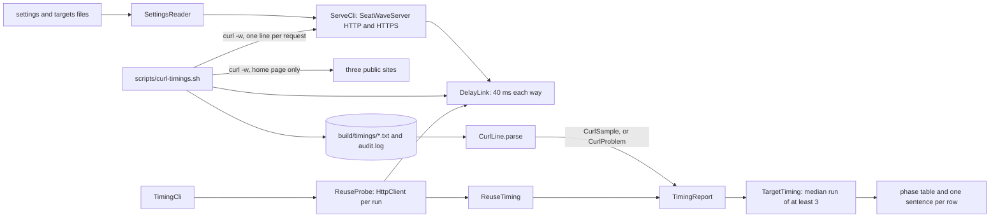

# Architecture

## The seven packages

| Package | What it owns |
|---|---|
| `config` | `SettingsReader`: reads typed values from a settings file and collects every missing or invalid key. There are no defaults anywhere. |
| `server` | `SeatMapJson` (Module 1's event list and 36,894-byte seat map, built in memory), `SeatWaveServer` (the JDK HTTP and HTTPS server on 127.0.0.1, with `Server-Timing` on every response) and the `ServeCli` entry point. |
| `link` | `DelayLink`, the loopback forwarder that holds every chunk for a one-way delay, with `LinkSettings` and `HandshakeDelay`. |
| `tls` | `TlsMaterial` (a server context from a TEST keystore; a client context that trusts only the TEST CA), `TlsSettings`, `TlsScenario`, `HandshakeOutcome`, `TlsFailures` and the `TlsFailuresCli` entry point. |
| `timing` | The Java timing client: `ReuseProbe` (a new `HttpClient` per run, a request on a new connection, then one on the same), `Scenario`, `Scheme`, `TimingSettings` and the `TimingCli` entry point. |
| `report` | The report's values and its writer: `Phase`, `PhaseTimings` (the invariant), `Runs` (at least three runs, the median), `CurlLine` (the parser), `CurlSample`, `CurlProblem`, `ConnectionKind`, `TargetTiming`, `ReuseSample`, `ReuseTiming`, `TimingReport` and the `ReportCli` entry point. |
| `model` | Lab 3's page model: `Protocol`, `ModelSettings`, `PageLoadModel`, `PageModelReport` and the `PageModelCli` entry point. |

## The dependency rule

- `server`, `link` and `report` depend on nothing in this project but `config` (`report` not even on that).
- `tls` uses `server` (it starts a server per scenario). `timing` uses `server`, `link`, `tls` and `report`. `model` uses `report.ConnectionKind` and `config`.
- No package depends on `timing`, `model` or a `*Cli` class.
- The `*Cli` classes are the only code that prints or exits. Everything else returns values.

## The data flow of one timing report

## One request through the report, step by step

1. `scripts/curl-timings.sh` checks the target against its allow-list (SeatWave on 127.0.0.1, or a public home page with at most 3 runs), then runs `curl -w` once per run. curl prints its cumulative clock readings: `time_namelookup`, `time_connect`, `time_appconnect`, `time_starttransfer` and `time_total`, plus the HTTP version, the status, the size, the number of new connections and the `Server-Timing` header.
2. `CurlLine.parse` reads one line. A reading of 0 means the step did not happen (no TLS for plain HTTP; no handshakes on a reused connection), so that phase ends where the previous one ended. Each phase is the difference of two readings, kept exact with `BigDecimal`.
3. `PhaseTimings.of` checks the invariant and returns the timings or the reason they break it. `CurlSample` refuses anything but a 2xx status.
4. `TimingReport.group` puts samples into groups by target and kind of connection. A group with fewer than 3 runs is listed as refused. Every other group becomes a `TargetTiming`, whose row is its median run by total time.
5. The writer prints the median run's own five phases, its total, the fastest and slowest totals and the dominant phase, then one sentence per row.

## Decisions and trade-offs

**The median run, not the median of each phase.** Medians taken phase by phase come from different runs and do not add up to any run's total. The report picks the run whose total is the median and prints its phases, so a row is one real request.

**A new `HttpClient` per run.** A client keeps its connections open for reuse, which is what service code wants (create it once, share it). The probe needs a new connection on purpose, and a new client is the JDK's only way to force one. The second request of each run uses the same client and so the same connection; the link's connection count proves it.

**A link instead of the operating system's traffic control.** macOS has no `tc`, and changing its packet filter needs administrator rights. A forwarder on the loopback address adds the same fixed delay in plain Java and leaves the system's settings alone. It cannot delay the TCP handshake, which the kernel completes at once, so `HandshakeDelay.ONE_ROUND_TRIP` charges that round trip to the first client bytes. The total of a new connection is then right; a timing tool shows the extra round trip inside the TLS phase (or the first byte, for plain HTTP), not as "connect".

**The link sleeps in halves.** On macOS a sleeping thread can wake late by a share of the sleep, because the system coalesces timers. The writer sleeps half the remaining time, again and again, and spins only for the last fifth of a millisecond, so the link adds its delay within a fraction of a millisecond.

**A test CA, not a self-signed server certificate.** A client then validates the server's certificate exactly as it would a real one: chain, dates and name. The expired and wrong-name certificates are refused by the JDK's normal checks, not by special code.

**No "trust everything" switch.** Making a timing script pass by turning off certificate checks is failing open. The client trusts the TEST CA and nothing else, and there is no code path that skips verification.

**HTTP/2 is asked for and recorded, not assumed.** The JDK server speaks HTTP/1.1 only, so a client that asks for HTTP/2 falls back. The table prints what was asked for and what was answered. The public sites, measured with curl, did answer HTTP/2.

**A model for Lab 3.** HTTP/2 and HTTP/3 servers are not in the JDK, and a lossy link needs administrator rights. The page model applies stated rules to a timeline: setup round trips, slow start, independent losses, fast and tail recovery, and in-order delivery per connection (TCP) or per stream (QUIC). It prints its assumptions above its table.

## The invariant and where it is enforced

**Every timing in the report is the median of at least 3 runs, and every phase row is one real run whose five phases are each zero or more and sum to its total within 1 ms.**

1. `PhaseTimings`, in its compact constructor: no negative phase, and the sum within `SUM_TOLERANCE` of the total. A `PhaseTimings` that breaks either rule cannot exist. Tested in `PhaseTimingsTest`.
2. `CurlLine.parse` returns a `CurlProblem.Rejected` for readings out of order, a failed request or a non-2xx status, instead of a sample. Tested in `CurlLineTest`.
3. `Runs.requireEnough`, called by `TargetTiming` and `ReuseTiming` in their compact constructors: fewer than `MINIMUM_RUNS` (3) runs cannot form a row. Tested in `TimingReportTest`.
4. `TimingReport.group` turns a small group into a refused line, never a row; `ReportCli` exits 1 when any line or group was refused.

## Limits of the teaching build

- The servers listen on 127.0.0.1 only and speak HTTP/1.1.
- The link's connection limit closes extra connections at once; a production proxy would also close idle ones.
- `ServeCli` sets `jdk.httpserver.maxConnections` before the first server starts, because the JDK server reads it once.
- The command-line classes are not covered by the unit tests, because they call `System.exit`; `TimingCli.run` is tested directly.

## How to extend it

To add a phase, add a value to `Phase`, a field to `PhaseTimings` and its case to `PhaseTimings.of(Phase)`; the `switch` then fails to compile until every use handles it, and `CurlLine` must read the new reading. To add a protocol to the model, add a value to `Protocol`; the `switch` statements in `PageLoadModel` fail to compile until it has its setup round trips and its delivery rule.
